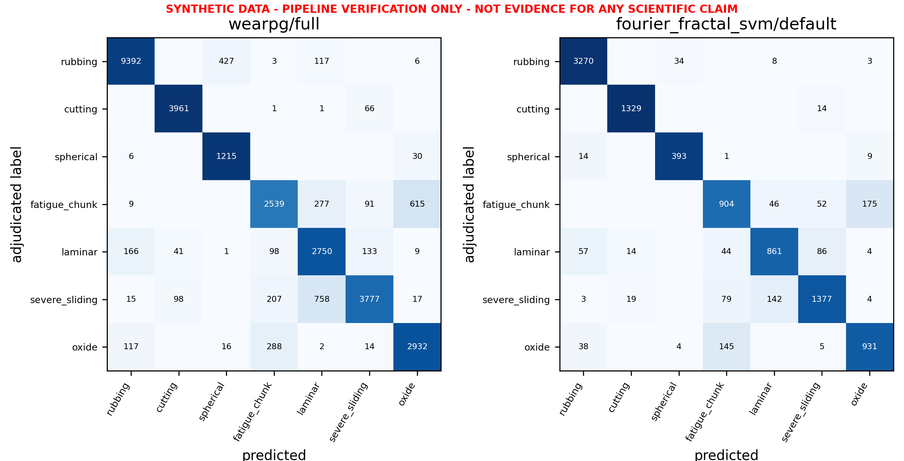
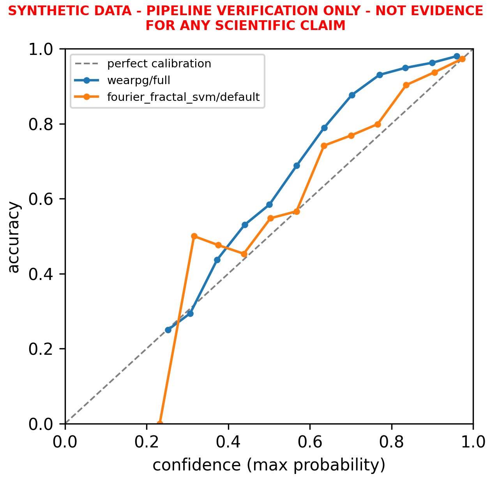
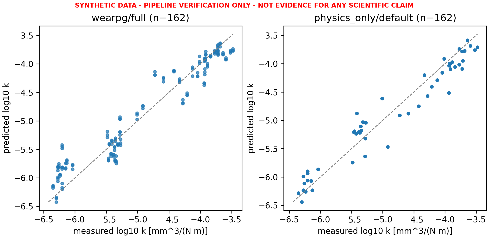
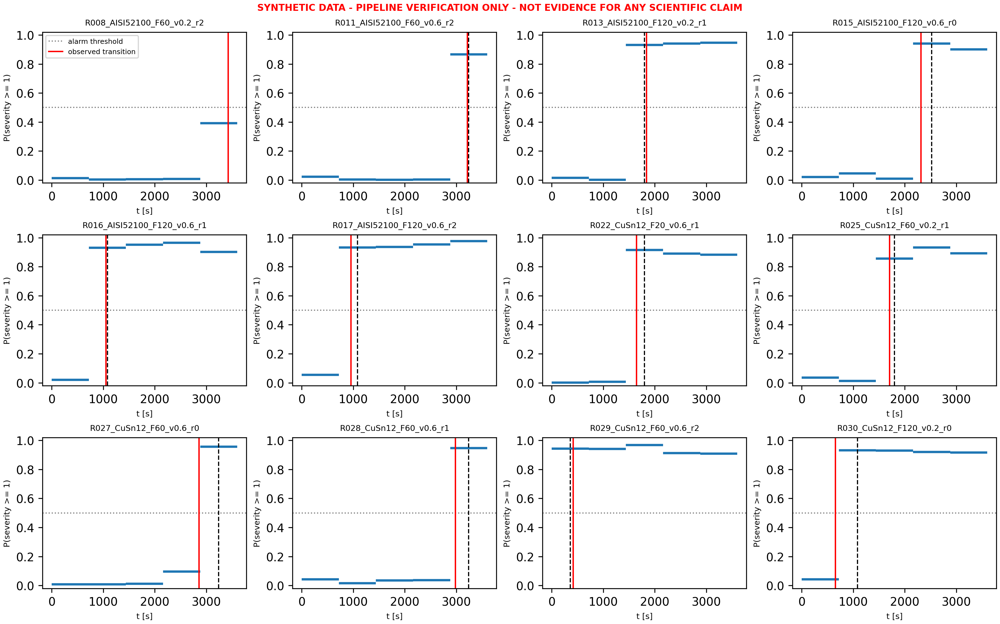
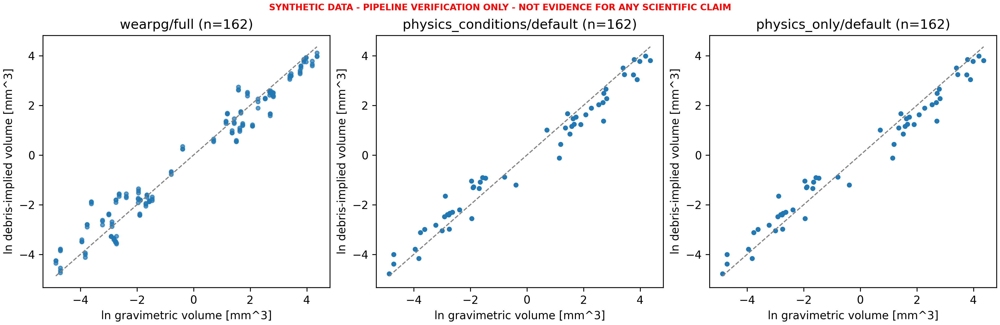

# wearpg results report

**SYNTHETIC DATA - PIPELINE VERIFICATION ONLY - NOT EVIDENCE FOR ANY SCIENTIFIC CLAIM**

**VERIFICATION ONLY - NO GO/NO-GO DECISION**

Results directory: `outputs/pilot`

## Dataset

| key | value |
|---|---|
| schema_version | 1.0 |
| is_synthetic | True |
| name | synthetic_pilot_v2 |
| generator | wearpg.synthetic |
| seed | 0 |
| warning | SYNTHETIC DATA - PIPELINE VERIFICATION ONLY - NOT EVIDENCE FOR ANY SCIENTIFIC CLAIM |
| n_specimens | 54 |
| n_runs | 54 |
| n_samples | 270 |
| n_images | 6652 |
| n_particles | 10065 |
| n_views | 16103 |
| n_labels | 24321 |
| n_labels_adjudicated | 10065 |
| n_materials | 3 |
| n_conditions | 18 |
| n_labelled_particles | 10065 |

## Dataset summary

| material_id | condition_id | load [N] | speed [m/s] | runs | severe runs | samples | particles detected | particles stored | labelled |
|---|---|---|---|---|---|---|---|---|---|
| AA6061 | AA6061_F120_v0.2 | 120 | 0.200 | 3 | 3 | 15 | 1966 | 794 | 794 |
| AA6061 | AA6061_F120_v0.6 | 120 | 0.600 | 3 | 3 | 15 | 9187 | 867 | 867 |
| AA6061 | AA6061_F20_v0.2 | 20.0 | 0.200 | 3 | 1 | 15 | 322 | 318 | 318 |
| AA6061 | AA6061_F20_v0.6 | 20.0 | 0.600 | 3 | 1 | 15 | 690 | 558 | 558 |
| AA6061 | AA6061_F60_v0.2 | 60.0 | 0.200 | 3 | 3 | 15 | 2072 | 590 | 590 |
| AA6061 | AA6061_F60_v0.6 | 60.0 | 0.600 | 3 | 3 | 15 | 5089 | 837 | 837 |
| AISI52100 | AISI52100_F120_v0.2 | 120 | 0.200 | 3 | 1 | 15 | 743 | 437 | 437 |
| AISI52100 | AISI52100_F120_v0.6 | 120 | 0.600 | 3 | 3 | 15 | 2498 | 799 | 799 |
| AISI52100 | AISI52100_F20_v0.2 | 20.0 | 0.200 | 3 | 0 | 15 | 237 | 195 | 195 |
| AISI52100 | AISI52100_F20_v0.6 | 20.0 | 0.600 | 3 | 0 | 15 | 290 | 290 | 290 |
| AISI52100 | AISI52100_F60_v0.2 | 60.0 | 0.200 | 3 | 1 | 15 | 303 | 303 | 303 |
| AISI52100 | AISI52100_F60_v0.6 | 60.0 | 0.600 | 3 | 1 | 15 | 692 | 492 | 492 |
| CuSn12 | CuSn12_F120_v0.2 | 120 | 0.200 | 3 | 2 | 15 | 1213 | 647 | 647 |
| CuSn12 | CuSn12_F120_v0.6 | 120 | 0.600 | 3 | 3 | 15 | 8719 | 865 | 865 |
| CuSn12 | CuSn12_F20_v0.2 | 20.0 | 0.200 | 3 | 0 | 15 | 184 | 184 | 184 |
| CuSn12 | CuSn12_F20_v0.6 | 20.0 | 0.600 | 3 | 1 | 15 | 933 | 584 | 584 |
| CuSn12 | CuSn12_F60_v0.2 | 60.0 | 0.200 | 3 | 1 | 15 | 691 | 490 | 490 |
| CuSn12 | CuSn12_F60_v0.6 | 60.0 | 0.600 | 3 | 3 | 15 | 4246 | 815 | 815 |
| all |  | - | - | 54 | 30 | 270 | 40075 | 10065 | 10065 |

## Go/no-go gates

decision_valid: false; overall: FAIL (details: ../gates/gates.md)

| gate | status | message |
|---|---|---|
| pilot | PASS | (a) 18/18 conditions have >= 3 runs; (b) 4/4 run aggregates with p_adj < 0.05 and abs(rho) >= 0.3 (best median_log_ecd: rho=0.83, p_adj=0.0008) |
| graph_value | FAIL | particle_gnn macro-F1 beats 0/2 baselines (lower CI bound > 0) |
| mechanism | PASS | agreement PASS (kappa=0.672 [cohen], 2 raters, 10065 multi-rated items); validity PASS (kappa=0.941, n=4191); SEM/EDS coverage PASS (0.416 of 10065 labelled particles) |
| wear | NOT EVALUABLE | repeatability PASS (median SD log10 k = 0.165 over 10 regime-homogeneous conditions, 24 runs in regime-mixed conditions); external NOT EVALUABLE (no external run predictions) |
| wear_rate | FAIL | wearpg/full: run MAE beats 1/2 baselines (upper CI bound < 0) FAIL; volume slope 0.907 [0.862, 0.955], CCC 0.978 [0.966, 0.986] FAIL; within-condition Spearman 0.907 [0.517, 0.946] PASS |
| portfolio | FAIL | runs mae FAIL (wearpg 0.2035 vs best baseline physics_only 0.2); particles macro_f1 FAIL (wearpg 0.8552 vs best baseline fourier_fractal_svm 0.8809) |

## Particle-level mechanism classification

| protocol | model | variant | Macro-F1 | Bal. acc. | Acc. | ECE | Brier | Log loss | n |
|---|---|---|---|---|---|---|---|---|---|
| cv | wearpg | full | 0.855 [0.846, 0.863] | 0.875 [0.867, 0.882] | 0.880 [0.870, 0.890] | 0.108 [0.099, 0.117] | 0.202 [0.191, 0.212] | 0.440 [0.422, 0.457] | 10065 |
| cv | wearpg | no_mechanism_link | 0.869 [0.863, 0.875] | 0.883 [0.877, 0.889] | 0.889 [0.881, 0.899] | 0.102 [0.094, 0.112] | 0.187 [0.176, 0.197] | 0.417 [0.398, 0.433] | 10065 |
| cv | wearpg | no_physics | 0.862 [0.855, 0.868] | 0.877 [0.871, 0.883] | 0.882 [0.874, 0.893] | 0.105 [0.096, 0.115] | 0.197 [0.186, 0.208] | 0.430 [0.411, 0.448] | 10065 |
| cv | wearpg | with_conditions | 0.860 [0.853, 0.866] | 0.876 [0.870, 0.882] | 0.883 [0.874, 0.893] | 0.105 [0.097, 0.115] | 0.198 [0.187, 0.207] | 0.433 [0.415, 0.449] | 10065 |
| cv | contour_cnn | default | 0.871 [0.864, 0.878] | 0.881 [0.874, 0.887] | 0.893 [0.886, 0.902] | 0.076 [0.068, 0.087] | 0.174 [0.163, 0.184] | 0.390 [0.373, 0.407] | 10065 |
| cv | fourier_fractal_svm | default | 0.881 [0.875, 0.887] | 0.882 [0.875, 0.887] | 0.901 [0.894, 0.909] | 0.019 [0.017, 0.026] | 0.154 [0.143, 0.163] | 0.318 [0.298, 0.337] | 10065 |
| cv | multiview_svm | default | 0.881 [0.875, 0.887] | 0.880 [0.874, 0.887] | 0.900 [0.893, 0.908] | 0.051 [0.047, 0.057] | 0.167 [0.156, 0.176] | 0.349 [0.327, 0.369] | 10065 |
| cv | particle_gnn | default | 0.875 [0.868, 0.881] | 0.885 [0.878, 0.892] | 0.896 [0.890, 0.903] | 0.083 [0.076, 0.092] | 0.173 [0.164, 0.180] | 0.389 [0.374, 0.403] | 10065 |
| cv | resnet18 | default | 0.859 [0.852, 0.867] | 0.871 [0.863, 0.878] | 0.882 [0.874, 0.892] | 0.085 [0.076, 0.097] | 0.192 [0.182, 0.201] | 0.420 [0.402, 0.435] | 10065 |

## Sample-level severity

| protocol | model | variant | Macro-F1 | Bal. acc. | Ordinal MAE | QWK | n |
|---|---|---|---|---|---|---|---|
| cv | wearpg | full | 0.607 [0.594, 0.617] | 0.665 [0.661, 0.667] | 0.119 [0.093, 0.148] | 0.920 [0.895, 0.936] | 270 |
| cv | wearpg | no_mechanism_link | 0.607 [0.594, 0.618] | 0.665 [0.661, 0.667] | 0.119 [0.089, 0.145] | 0.919 [0.894, 0.936] | 270 |
| cv | wearpg | no_physics | 0.607 [0.594, 0.618] | 0.665 [0.661, 0.667] | 0.119 [0.089, 0.145] | 0.919 [0.894, 0.936] | 270 |
| cv | wearpg | with_conditions | 0.606 [0.593, 0.617] | 0.665 [0.661, 0.667] | 0.119 [0.089, 0.145] | 0.920 [0.895, 0.936] | 270 |
| cv | conditions_only | default | 0.524 [0.483, 0.561] | 0.551 [0.506, 0.596] | 0.319 [0.222, 0.419] | 0.634 [0.515, 0.740] | 270 |
| cv | descriptor_agg_rf | default | 0.707 [0.639, 0.776] | 0.704 [0.648, 0.765] | 0.119 [0.081, 0.158] | 0.919 [0.894, 0.939] | 270 |
| cv | physics_conditions | default | 0.601 [0.548, 0.660] | 0.624 [0.567, 0.677] | 0.170 [0.107, 0.248] | 0.848 [0.753, 0.918] | 270 |
| cv | physics_only | default | 0.601 [0.548, 0.660] | 0.624 [0.567, 0.677] | 0.170 [0.107, 0.248] | 0.848 [0.753, 0.918] | 270 |

## Specific wear rate

| protocol | level | model | variant | MAE | RMSE | R2 | Bias | Spearman | Within-cond. Spearman | n |
|---|---|---|---|---|---|---|---|---|---|---|
| cv | run | wearpg | full | 0.203 [0.160, 0.246] | 0.260 [0.209, 0.307] | 0.927 [0.893, 0.951] | 0.031 [-0.036, 0.095] | 0.959 [0.919, 0.975] | 0.907 [0.517, 0.946] | 54 |
| cv | run | wearpg | no_mechanism_link | 0.204 [0.164, 0.246] | 0.257 [0.214, 0.298] | 0.929 [0.904, 0.948] | 0.004 [-0.066, 0.075] | 0.952 [0.907, 0.971] | 0.914 [0.583, 0.955] | 54 |
| cv | run | wearpg | no_physics | 0.379 [0.317, 0.441] | 0.447 [0.381, 0.508] | 0.784 [0.700, 0.841] | 0.025 [-0.090, 0.145] | 0.851 [0.756, 0.908] | 0.903 [0.642, 0.950] | 54 |
| cv | run | wearpg | with_conditions | 0.133 [0.106, 0.160] | 0.167 [0.136, 0.195] | 0.970 [0.955, 0.980] | -0.012 [-0.055, 0.031] | 0.972 [0.943, 0.981] | 0.908 [0.522, 0.945] | 54 |
| cv | run | conditions_only | default | 0.423 [0.351, 0.495] | 0.509 [0.438, 0.581] | 0.720 [0.595, 0.803] | -0.041 [-0.172, 0.097] | 0.859 [0.767, 0.902] | -0.110 [-0.480, 0.217] | 54 |
| cv | run | descriptor_agg_rf | default | 0.367 [0.303, 0.428] | 0.437 [0.370, 0.497] | 0.794 [0.705, 0.854] | 0.016 [-0.100, 0.131] | 0.844 [0.749, 0.903] | 0.825 [0.452, 0.909] | 54 |
| cv | run | physics_conditions | default | 0.201 [0.168, 0.234] | 0.238 [0.199, 0.276] | 0.939 [0.905, 0.960] | -0.019 [-0.080, 0.041] | 0.958 [0.914, 0.978] | 0.931 [0.740, 0.973] | 54 |
| cv | run | physics_only | default | 0.200 [0.168, 0.233] | 0.237 [0.197, 0.275] | 0.939 [0.905, 0.961] | -0.020 [-0.080, 0.040] | 0.959 [0.914, 0.978] | 0.934 [0.745, 0.974] | 54 |
| cv | sample | wearpg | full | - | - | - | - | - | - | 0 |
| cv | sample | wearpg | no_mechanism_link | - | - | - | - | - | - | 0 |
| cv | sample | wearpg | no_physics | - | - | - | - | - | - | 0 |
| cv | sample | wearpg | with_conditions | - | - | - | - | - | - | 0 |
| cv | sample | conditions_only | default | - | - | - | - | - | - | 0 |
| cv | sample | descriptor_agg_rf | default | - | - | - | - | - | - | 0 |
| cv | sample | physics_conditions | default | - | - | - | - | - | - | 0 |
| cv | sample | physics_only | default | - | - | - | - | - | - | 0 |

## Paired comparisons

Paired comparisons: difference with 95 % CI, relative difference and multiplicity-adjusted p-value. Method: paired cluster bootstrap, holm within (protocol, level, family, metric). Claim metrics with p-values; every metric's CI is in metrics/comparisons.csv.

| protocol | level | family | metric | A | B | diff [CI] | rel. diff | p | p adj. |
|---|---|---|---|---|---|---|---|---|---|
| cv | particle | ablations | macro_f1 | wearpg/full | wearpg/no_mechanism_link | -0.014 [-0.021, -0.008] | -0.016 | <0.001 | 0.003 |
| cv | particle | ablations | macro_f1 | wearpg/full | wearpg/no_physics | -0.007 [-0.015, 0.000] | -0.008 | 0.063 | 0.126 |
| cv | particle | ablations | macro_f1 | wearpg/full | wearpg/with_conditions | -0.005 [-0.012, 0.001] | -0.006 | 0.142 | 0.142 |
| cv | run | ablations | mae | wearpg/full | wearpg/no_mechanism_link | -0.001 [-0.030, 0.029] | -0.004 | 0.947 | 0.947 |
| cv | run | ablations | mae | wearpg/full | wearpg/no_physics | -0.176 [-0.226, -0.128] | -0.463 | <0.001 | 0.003 |
| cv | run | ablations | mae | wearpg/full | wearpg/with_conditions | 0.070 [0.033, 0.107] | 0.529 | <0.001 | 0.003 |
| cv | sample | ablations | qwk | wearpg/full | wearpg/no_mechanism_link | 0.000 [-0.000, 0.001] | 0.000 | 0.684 | 1.000 |
| cv | sample | ablations | qwk | wearpg/full | wearpg/no_physics | 0.000 [-0.000, 0.001] | 0.000 | 0.684 | 1.000 |
| cv | sample | ablations | qwk | wearpg/full | wearpg/with_conditions | -0.000 [-0.001, 0.000] | -0.000 | 0.938 | 1.000 |
| cv | particle | baselines | macro_f1 | wearpg/full | contour_cnn/default | -0.016 [-0.024, -0.008] | -0.019 | <0.001 | 0.005 |
| cv | particle | baselines | macro_f1 | wearpg/full | fourier_fractal_svm/default | -0.026 [-0.034, -0.019] | -0.029 | <0.001 | 0.005 |
| cv | particle | baselines | macro_f1 | wearpg/full | multiview_svm/default | -0.025 [-0.034, -0.018] | -0.029 | <0.001 | 0.005 |
| cv | particle | baselines | macro_f1 | wearpg/full | particle_gnn/default | -0.019 [-0.029, -0.010] | -0.022 | <0.001 | 0.005 |
| cv | particle | baselines | macro_f1 | wearpg/full | resnet18/default | -0.004 [-0.013, 0.004] | -0.005 | 0.346 | 0.346 |
| cv | run | baselines | mae | wearpg/full | conditions_only/default | -0.220 [-0.308, -0.135] | -0.519 | <0.001 | 0.004 |
| cv | run | baselines | mae | wearpg/full | descriptor_agg_rf/default | -0.163 [-0.226, -0.104] | -0.445 | <0.001 | 0.004 |
| cv | run | baselines | mae | wearpg/full | physics_conditions/default | 0.003 [-0.049, 0.053] | 0.013 | 0.956 | 1.000 |
| cv | run | baselines | mae | wearpg/full | physics_only/default | 0.003 [-0.048, 0.054] | 0.017 | 0.928 | 1.000 |
| cv | sample | baselines | qwk | wearpg/full | conditions_only/default | 0.286 [0.176, 0.411] | 0.451 | <0.001 | 0.004 |
| cv | sample | baselines | qwk | wearpg/full | descriptor_agg_rf/default | 0.001 [-0.029, 0.029] | 0.001 | 0.911 | 0.911 |
| cv | sample | baselines | qwk | wearpg/full | physics_conditions/default | 0.071 [-0.002, 0.167] | 0.084 | 0.059 | 0.177 |
| cv | sample | baselines | qwk | wearpg/full | physics_only/default | 0.071 [-0.002, 0.167] | 0.084 | 0.059 | 0.177 |

## Per-class metrics

Models: wearpg/full, fourier_fractal_svm/default.

| model | variant | class | Sensitivity | Specificity | F1 | n |
|---|---|---|---|---|---|---|
| wearpg | full | rubbing | 0.944 [0.934, 0.955] | 0.985 [0.980, 0.988] | 0.956 [0.949, 0.962] | 3315 |
| wearpg | full | cutting | 0.983 [0.976, 0.990] | 0.995 [0.992, 0.997] | 0.975 [0.965, 0.983] | 1343 |
| wearpg | full | spherical | 0.971 [0.954, 0.987] | 0.985 [0.980, 0.989] | 0.836 [0.793, 0.871] | 417 |
| wearpg | full | fatigue_chunk | 0.719 [0.691, 0.743] | 0.978 [0.974, 0.981] | 0.762 [0.739, 0.780] | 1177 |
| wearpg | full | laminar | 0.860 [0.832, 0.884] | 0.957 [0.950, 0.965] | 0.774 [0.750, 0.800] | 1066 |
| wearpg | full | severe_sliding | 0.775 [0.751, 0.799] | 0.988 [0.985, 0.991] | 0.844 [0.827, 0.860] | 1624 |
| wearpg | full | oxide | 0.870 [0.847, 0.894] | 0.975 [0.971, 0.978] | 0.840 [0.813, 0.867] | 1123 |
| fourier_fractal_svm | default | rubbing | 0.986 [0.982, 0.990] | 0.983 [0.979, 0.987] | 0.977 [0.973, 0.980] | 3315 |
| fourier_fractal_svm | default | cutting | 0.990 [0.985, 0.994] | 0.996 [0.995, 0.998] | 0.983 [0.978, 0.987] | 1343 |
| fourier_fractal_svm | default | spherical | 0.942 [0.916, 0.967] | 0.996 [0.995, 0.997] | 0.927 [0.907, 0.946] | 417 |
| fourier_fractal_svm | default | fatigue_chunk | 0.768 [0.741, 0.792] | 0.970 [0.966, 0.974] | 0.769 [0.745, 0.787] | 1177 |
| fourier_fractal_svm | default | laminar | 0.808 [0.786, 0.829] | 0.978 [0.975, 0.982] | 0.811 [0.794, 0.830] | 1066 |
| fourier_fractal_svm | default | severe_sliding | 0.848 [0.828, 0.866] | 0.981 [0.978, 0.985] | 0.872 [0.857, 0.883] | 1624 |
| fourier_fractal_svm | default | oxide | 0.829 [0.807, 0.851] | 0.978 [0.975, 0.982] | 0.828 [0.802, 0.853] | 1123 |

## Metrics by group

Models: wearpg/full, fourier_fractal_svm/default.

| protocol | model | variant | group_col | group | Macro-F1 | Bal. acc. | Acc. | ECE | Brier | Log loss | n |
|---|---|---|---|---|---|---|---|---|---|---|---|
| cv | wearpg | full | material_id | AA6061 | 0.853 | 0.873 | 0.876 | 0.105 | 0.208 | 0.448 | 3964 |
| cv | wearpg | full | material_id | AISI52100 | 0.864 | 0.880 | 0.895 | 0.120 | 0.185 | 0.419 | 2516 |
| cv | wearpg | full | material_id | CuSn12 | 0.851 | 0.873 | 0.873 | 0.105 | 0.207 | 0.446 | 3585 |
| cv | wearpg | full | magnification | 200.0 | 0.848 | 0.872 | 0.873 | 0.100 | 0.208 | 0.452 | 4988 |
| cv | wearpg | full | magnification | 500.0 | 0.860 | 0.877 | 0.887 | 0.115 | 0.196 | 0.429 | 5077 |
| cv | wearpg | full | source_subset | multiview | 0.853 | 0.870 | 0.875 | 0.133 | 0.217 | 0.479 | 3019 |
| cv | wearpg | full | source_subset | eds | 0.861 | 0.884 | 0.886 | 0.110 | 0.196 | 0.431 | 3103 |
| cv | fourier_fractal_svm | default | material_id | AA6061 | 0.877 | 0.877 | 0.896 | 0.016 | 0.157 | 0.320 | 3964 |
| cv | fourier_fractal_svm | default | material_id | AISI52100 | 0.885 | 0.885 | 0.910 | 0.023 | 0.145 | 0.307 | 2516 |
| cv | fourier_fractal_svm | default | material_id | CuSn12 | 0.882 | 0.885 | 0.899 | 0.024 | 0.156 | 0.323 | 3585 |
| cv | fourier_fractal_svm | default | magnification | 200.0 | 0.881 | 0.883 | 0.896 | 0.021 | 0.162 | 0.337 | 4988 |
| cv | fourier_fractal_svm | default | magnification | 500.0 | 0.880 | 0.880 | 0.905 | 0.021 | 0.146 | 0.300 | 5077 |
| cv | fourier_fractal_svm | default | source_subset | multiview | 0.876 | 0.876 | 0.895 | 0.023 | 0.165 | 0.337 | 3019 |
| cv | fourier_fractal_svm | default | source_subset | eds | 0.882 | 0.884 | 0.903 | 0.019 | 0.152 | 0.314 | 3103 |

## Transition timing

| protocol | model | variant | MAE [s] | Bias [s] | MAE [intervals] | Detection | Early alarm | False alarm | Oracle floor [s] | Interval [s] | n transition | n stable |
|---|---|---|---|---|---|---|---|---|---|---|---|---|
| cv | wearpg | full | 193 | 101 | 0.268 | 0.944 | 0.000 | 0.042 | 183 | 720 | 30 | 24 |
| cv | wearpg | no_mechanism_link | 197 | 129 | 0.274 | 0.933 | 0.000 | 0.042 | 183 | 720 | 30 | 24 |
| cv | wearpg | no_physics | 197 | 129 | 0.274 | 0.933 | 0.000 | 0.042 | 183 | 720 | 30 | 24 |
| cv | wearpg | with_conditions | 193 | 105 | 0.268 | 0.933 | 0.000 | 0.042 | 183 | 720 | 30 | 24 |
| cv | conditions_only | default | 864 | 345 | 1.200 | 0.867 | 0.200 | 0.375 | 183 | 720 | 30 | 24 |
| cv | descriptor_agg_rf | default | 304 | -31.2 | 0.422 | 1.000 | 0.056 | 0.056 | 183 | 720 | 30 | 24 |
| cv | physics_conditions | default | 419 | 297 | 0.582 | 0.867 | 0.000 | 0.000 | 183 | 720 | 30 | 24 |
| cv | physics_only | default | 419 | 297 | 0.582 | 0.867 | 0.000 | 0.000 | 183 | 720 | 30 | 24 |

## Volume consistency

| protocol | model | variant | Mean ln ratio | SD ln ratio | Slope | Intercept | R2 | CCC | n |
|---|---|---|---|---|---|---|---|---|---|
| cv | wearpg | full | 0.004 | 0.580 | 0.907 | -0.006 | 0.961 | 0.978 | 54 |
| cv | wearpg | no_mechanism_link | -0.209 | 0.704 | 0.792 | -0.231 | 0.972 | 0.959 | 54 |
| cv | wearpg | no_physics | -1.213 | 0.803 | 0.780 | -1.236 | 0.950 | 0.854 | 54 |
| cv | wearpg | with_conditions | 0.030 | 0.579 | 0.910 | 0.020 | 0.961 | 0.978 | 54 |
| cv | physics_conditions | default | -0.045 | 0.549 | 0.878 | -0.058 | 0.972 | 0.979 | 54 |
| cv | physics_only | default | -0.045 | 0.549 | 0.878 | -0.058 | 0.972 | 0.979 | 54 |

## Excluded runs (counted, not scored)

No run was excluded.

## Synthetic ground-truth diagnostics (never headline results)

| table | protocol | level | model | variant | metric | point | lo | hi | n |
|---|---|---|---|---|---|---|---|---|---|
| classification | cv | - | contour_cnn | default | macro_f1_gt | 0.891 | 0.885 | 0.897 | 10065 |
| classification | cv | - | contour_cnn | default | balanced_accuracy_gt | 0.904 | 0.899 | 0.909 | 10065 |
| classification | cv | - | contour_cnn | default | accuracy_gt | 0.913 | 0.905 | 0.921 | 10065 |
| classification | cv | - | contour_cnn | default | ece_gt | 0.096 | 0.088 | 0.105 | 10065 |
| classification | cv | - | contour_cnn | default | brier_gt | 0.143 | 0.134 | 0.151 | 10065 |
| classification | cv | - | contour_cnn | default | log_loss_gt | 0.320 | 0.307 | 0.331 | 10065 |
| classification | cv | - | fourier_fractal_svm | default | macro_f1_gt | 0.902 | 0.897 | 0.907 | 10065 |
| classification | cv | - | fourier_fractal_svm | default | balanced_accuracy_gt | 0.905 | 0.900 | 0.910 | 10065 |
| classification | cv | - | fourier_fractal_svm | default | accuracy_gt | 0.920 | 0.914 | 0.928 | 10065 |
| classification | cv | - | fourier_fractal_svm | default | ece_gt | 0.039 | 0.035 | 0.044 | 10065 |
| classification | cv | - | fourier_fractal_svm | default | brier_gt | 0.119 | 0.110 | 0.127 | 10065 |
| classification | cv | - | fourier_fractal_svm | default | log_loss_gt | 0.226 | 0.211 | 0.238 | 10065 |
| classification | cv | - | multiview_svm | default | macro_f1_gt | 0.901 | 0.896 | 0.906 | 10065 |
| classification | cv | - | multiview_svm | default | balanced_accuracy_gt | 0.903 | 0.898 | 0.909 | 10065 |
| classification | cv | - | multiview_svm | default | accuracy_gt | 0.919 | 0.912 | 0.926 | 10065 |
| classification | cv | - | multiview_svm | default | ece_gt | 0.070 | 0.065 | 0.074 | 10065 |
| classification | cv | - | multiview_svm | default | brier_gt | 0.133 | 0.123 | 0.141 | 10065 |
| classification | cv | - | multiview_svm | default | log_loss_gt | 0.263 | 0.246 | 0.277 | 10065 |
| classification | cv | - | particle_gnn | default | macro_f1_gt | 0.895 | 0.888 | 0.901 | 10065 |
| classification | cv | - | particle_gnn | default | balanced_accuracy_gt | 0.909 | 0.903 | 0.915 | 10065 |
| classification | cv | - | particle_gnn | default | accuracy_gt | 0.915 | 0.909 | 0.922 | 10065 |
| classification | cv | - | particle_gnn | default | ece_gt | 0.102 | 0.095 | 0.111 | 10065 |
| classification | cv | - | particle_gnn | default | brier_gt | 0.142 | 0.134 | 0.148 | 10065 |
| classification | cv | - | particle_gnn | default | log_loss_gt | 0.318 | 0.308 | 0.329 | 10065 |
| classification | cv | - | resnet18 | default | macro_f1_gt | 0.879 | 0.872 | 0.886 | 10065 |
| classification | cv | - | resnet18 | default | balanced_accuracy_gt | 0.895 | 0.888 | 0.902 | 10065 |
| classification | cv | - | resnet18 | default | accuracy_gt | 0.901 | 0.893 | 0.911 | 10065 |
| classification | cv | - | resnet18 | default | ece_gt | 0.104 | 0.094 | 0.116 | 10065 |
| classification | cv | - | resnet18 | default | brier_gt | 0.163 | 0.153 | 0.171 | 10065 |
| classification | cv | - | resnet18 | default | log_loss_gt | 0.351 | 0.337 | 0.363 | 10065 |
| classification | cv | - | wearpg | full | macro_f1_gt | 0.875 | 0.867 | 0.882 | 10065 |
| classification | cv | - | wearpg | full | balanced_accuracy_gt | 0.899 | 0.893 | 0.904 | 10065 |
| classification | cv | - | wearpg | full | accuracy_gt | 0.899 | 0.890 | 0.908 | 10065 |
| classification | cv | - | wearpg | full | ece_gt | 0.127 | 0.118 | 0.136 | 10065 |
| classification | cv | - | wearpg | full | brier_gt | 0.173 | 0.163 | 0.181 | 10065 |
| classification | cv | - | wearpg | full | log_loss_gt | 0.372 | 0.358 | 0.385 | 10065 |
| classification | cv | - | wearpg | no_mechanism_link | macro_f1_gt | 0.889 | 0.884 | 0.894 | 10065 |
| classification | cv | - | wearpg | no_mechanism_link | balanced_accuracy_gt | 0.907 | 0.903 | 0.911 | 10065 |
| classification | cv | - | wearpg | no_mechanism_link | accuracy_gt | 0.908 | 0.901 | 0.917 | 10065 |
| classification | cv | - | wearpg | no_mechanism_link | ece_gt | 0.121 | 0.114 | 0.131 | 10065 |
| classification | cv | - | wearpg | no_mechanism_link | brier_gt | 0.157 | 0.148 | 0.165 | 10065 |
| classification | cv | - | wearpg | no_mechanism_link | log_loss_gt | 0.347 | 0.334 | 0.358 | 10065 |
| classification | cv | - | wearpg | no_physics | macro_f1_gt | 0.882 | 0.876 | 0.887 | 10065 |
| classification | cv | - | wearpg | no_physics | balanced_accuracy_gt | 0.901 | 0.897 | 0.906 | 10065 |
| classification | cv | - | wearpg | no_physics | accuracy_gt | 0.902 | 0.894 | 0.911 | 10065 |
| classification | cv | - | wearpg | no_physics | ece_gt | 0.124 | 0.116 | 0.134 | 10065 |
| classification | cv | - | wearpg | no_physics | brier_gt | 0.168 | 0.157 | 0.176 | 10065 |
| classification | cv | - | wearpg | no_physics | log_loss_gt | 0.362 | 0.347 | 0.375 | 10065 |
| classification | cv | - | wearpg | with_conditions | macro_f1_gt | 0.880 | 0.875 | 0.886 | 10065 |
| classification | cv | - | wearpg | with_conditions | balanced_accuracy_gt | 0.900 | 0.896 | 0.906 | 10065 |
| classification | cv | - | wearpg | with_conditions | accuracy_gt | 0.902 | 0.894 | 0.912 | 10065 |
| classification | cv | - | wearpg | with_conditions | ece_gt | 0.125 | 0.117 | 0.133 | 10065 |
| classification | cv | - | wearpg | with_conditions | brier_gt | 0.168 | 0.159 | 0.176 | 10065 |
| classification | cv | - | wearpg | with_conditions | log_loss_gt | 0.365 | 0.351 | 0.376 | 10065 |
| regression | cv | sample | conditions_only | default | mae_gt | - | - | - | 0 |
| regression | cv | sample | conditions_only | default | rmse_gt | - | - | - | 0 |
| regression | cv | sample | conditions_only | default | r2_gt | - | - | - | 0 |
| regression | cv | sample | conditions_only | default | bias_gt | - | - | - | 0 |
| regression | cv | sample | conditions_only | default | spearman_gt | - | - | - | 0 |
| regression | cv | sample | conditions_only | default | within_condition_spearman_gt | - | - | - | 0 |
| regression | cv | sample | descriptor_agg_rf | default | mae_gt | - | - | - | 0 |
| regression | cv | sample | descriptor_agg_rf | default | rmse_gt | - | - | - | 0 |
| regression | cv | sample | descriptor_agg_rf | default | r2_gt | - | - | - | 0 |
| regression | cv | sample | descriptor_agg_rf | default | bias_gt | - | - | - | 0 |
| regression | cv | sample | descriptor_agg_rf | default | spearman_gt | - | - | - | 0 |
| regression | cv | sample | descriptor_agg_rf | default | within_condition_spearman_gt | - | - | - | 0 |
| regression | cv | sample | physics_conditions | default | mae_gt | 0.227 | 0.203 | 0.253 | 270 |
| regression | cv | sample | physics_conditions | default | rmse_gt | 0.289 | 0.260 | 0.318 | 270 |
| regression | cv | sample | physics_conditions | default | r2_gt | 0.913 | 0.881 | 0.934 | 270 |
| regression | cv | sample | physics_conditions | default | bias_gt | 0.023 | -0.026 | 0.072 | 270 |
| regression | cv | sample | physics_conditions | default | spearman_gt | 0.918 | 0.863 | 0.941 | 270 |
| regression | cv | sample | physics_conditions | default | within_condition_spearman_gt | 0.888 | 0.767 | 0.927 | 270 |
| regression | cv | sample | physics_only | default | mae_gt | 0.227 | 0.203 | 0.253 | 270 |
| regression | cv | sample | physics_only | default | rmse_gt | 0.289 | 0.260 | 0.318 | 270 |
| regression | cv | sample | physics_only | default | r2_gt | 0.913 | 0.881 | 0.934 | 270 |
| regression | cv | sample | physics_only | default | bias_gt | 0.023 | -0.026 | 0.072 | 270 |
| regression | cv | sample | physics_only | default | spearman_gt | 0.918 | 0.863 | 0.941 | 270 |
| regression | cv | sample | physics_only | default | within_condition_spearman_gt | 0.888 | 0.767 | 0.927 | 270 |
| regression | cv | sample | wearpg | full | mae_gt | 0.317 | 0.281 | 0.358 | 270 |
| regression | cv | sample | wearpg | full | rmse_gt | 0.402 | 0.356 | 0.452 | 270 |
| regression | cv | sample | wearpg | full | r2_gt | 0.831 | 0.774 | 0.869 | 270 |
| regression | cv | sample | wearpg | full | bias_gt | 0.059 | -0.099 | 0.224 | 270 |
| regression | cv | sample | wearpg | full | spearman_gt | 0.877 | 0.809 | 0.914 | 270 |
| regression | cv | sample | wearpg | full | within_condition_spearman_gt | 0.857 | 0.733 | 0.905 | 270 |
| regression | cv | sample | wearpg | no_mechanism_link | mae_gt | 0.267 | 0.229 | 0.308 | 270 |
| regression | cv | sample | wearpg | no_mechanism_link | rmse_gt | 0.339 | 0.293 | 0.384 | 270 |
| regression | cv | sample | wearpg | no_mechanism_link | r2_gt | 0.880 | 0.834 | 0.910 | 270 |
| regression | cv | sample | wearpg | no_mechanism_link | bias_gt | 0.130 | 0.068 | 0.193 | 270 |
| regression | cv | sample | wearpg | no_mechanism_link | spearman_gt | 0.899 | 0.841 | 0.930 | 270 |
| regression | cv | sample | wearpg | no_mechanism_link | within_condition_spearman_gt | 0.900 | 0.787 | 0.938 | 270 |
| regression | cv | sample | wearpg | no_physics | mae_gt | 0.889 | 0.797 | 0.979 | 270 |
| regression | cv | sample | wearpg | no_physics | rmse_gt | 0.996 | 0.908 | 1.075 | 270 |
| regression | cv | sample | wearpg | no_physics | r2_gt | -0.033 | -0.189 | 0.017 | 270 |
| regression | cv | sample | wearpg | no_physics | bias_gt | 0.189 | -0.035 | 0.414 | 270 |
| regression | cv | sample | wearpg | no_physics | spearman_gt | 0.007 | -0.202 | 0.239 | 270 |
| regression | cv | sample | wearpg | no_physics | within_condition_spearman_gt | -0.040 | -0.256 | 0.230 | 270 |
| regression | cv | sample | wearpg | with_conditions | mae_gt | 0.334 | 0.286 | 0.384 | 270 |
| regression | cv | sample | wearpg | with_conditions | rmse_gt | 0.431 | 0.373 | 0.486 | 270 |
| regression | cv | sample | wearpg | with_conditions | r2_gt | 0.807 | 0.732 | 0.857 | 270 |
| regression | cv | sample | wearpg | with_conditions | bias_gt | 0.253 | 0.191 | 0.317 | 270 |
| regression | cv | sample | wearpg | with_conditions | spearman_gt | 0.881 | 0.814 | 0.919 | 270 |
| regression | cv | sample | wearpg | with_conditions | within_condition_spearman_gt | 0.876 | 0.762 | 0.917 | 270 |
| regression | cv | run | conditions_only | default | mae_gt | 0.423 | 0.351 | 0.495 | 54 |
| regression | cv | run | conditions_only | default | rmse_gt | 0.508 | 0.437 | 0.579 | 54 |
| regression | cv | run | conditions_only | default | r2_gt | 0.721 | 0.595 | 0.803 | 54 |
| regression | cv | run | conditions_only | default | bias_gt | -0.041 | -0.174 | 0.094 | 54 |
| regression | cv | run | conditions_only | default | spearman_gt | 0.861 | 0.771 | 0.904 | 54 |
| regression | cv | run | conditions_only | default | within_condition_spearman_gt | -0.106 | -0.469 | 0.238 | 54 |
| regression | cv | run | descriptor_agg_rf | default | mae_gt | 0.366 | 0.303 | 0.427 | 54 |
| regression | cv | run | descriptor_agg_rf | default | rmse_gt | 0.437 | 0.370 | 0.498 | 54 |
| regression | cv | run | descriptor_agg_rf | default | r2_gt | 0.794 | 0.704 | 0.854 | 54 |
| regression | cv | run | descriptor_agg_rf | default | bias_gt | 0.016 | -0.101 | 0.130 | 54 |
| regression | cv | run | descriptor_agg_rf | default | spearman_gt | 0.846 | 0.752 | 0.905 | 54 |
| regression | cv | run | descriptor_agg_rf | default | within_condition_spearman_gt | 0.824 | 0.446 | 0.909 | 54 |
| regression | cv | run | physics_conditions | default | mae_gt | 0.200 | 0.167 | 0.234 | 54 |
| regression | cv | run | physics_conditions | default | rmse_gt | 0.238 | 0.198 | 0.276 | 54 |
| regression | cv | run | physics_conditions | default | r2_gt | 0.939 | 0.904 | 0.960 | 54 |
| regression | cv | run | physics_conditions | default | bias_gt | -0.020 | -0.081 | 0.041 | 54 |
| regression | cv | run | physics_conditions | default | spearman_gt | 0.958 | 0.910 | 0.977 | 54 |
| regression | cv | run | physics_conditions | default | within_condition_spearman_gt | 0.929 | 0.753 | 0.974 | 54 |
| regression | cv | run | physics_only | default | mae_gt | 0.200 | 0.168 | 0.233 | 54 |
| regression | cv | run | physics_only | default | rmse_gt | 0.237 | 0.196 | 0.275 | 54 |
| regression | cv | run | physics_only | default | r2_gt | 0.939 | 0.905 | 0.961 | 54 |
| regression | cv | run | physics_only | default | bias_gt | -0.020 | -0.080 | 0.040 | 54 |
| regression | cv | run | physics_only | default | spearman_gt | 0.958 | 0.911 | 0.978 | 54 |
| regression | cv | run | physics_only | default | within_condition_spearman_gt | 0.931 | 0.757 | 0.975 | 54 |
| regression | cv | run | wearpg | full | mae_gt | 0.203 | 0.160 | 0.246 | 54 |
| regression | cv | run | wearpg | full | rmse_gt | 0.260 | 0.208 | 0.308 | 54 |
| regression | cv | run | wearpg | full | r2_gt | 0.927 | 0.893 | 0.951 | 54 |
| regression | cv | run | wearpg | full | bias_gt | 0.031 | -0.036 | 0.095 | 54 |
| regression | cv | run | wearpg | full | spearman_gt | 0.961 | 0.922 | 0.976 | 54 |
| regression | cv | run | wearpg | full | within_condition_spearman_gt | 0.906 | 0.525 | 0.948 | 54 |
| regression | cv | run | wearpg | no_mechanism_link | mae_gt | 0.205 | 0.164 | 0.247 | 54 |
| regression | cv | run | wearpg | no_mechanism_link | rmse_gt | 0.258 | 0.214 | 0.299 | 54 |
| regression | cv | run | wearpg | no_mechanism_link | r2_gt | 0.928 | 0.903 | 0.948 | 54 |
| regression | cv | run | wearpg | no_mechanism_link | bias_gt | 0.003 | -0.067 | 0.074 | 54 |
| regression | cv | run | wearpg | no_mechanism_link | spearman_gt | 0.953 | 0.909 | 0.972 | 54 |
| regression | cv | run | wearpg | no_mechanism_link | within_condition_spearman_gt | 0.910 | 0.580 | 0.958 | 54 |
| regression | cv | run | wearpg | no_physics | mae_gt | 0.379 | 0.317 | 0.442 | 54 |
| regression | cv | run | wearpg | no_physics | rmse_gt | 0.448 | 0.380 | 0.509 | 54 |
| regression | cv | run | wearpg | no_physics | r2_gt | 0.783 | 0.699 | 0.842 | 54 |
| regression | cv | run | wearpg | no_physics | bias_gt | 0.024 | -0.090 | 0.144 | 54 |
| regression | cv | run | wearpg | no_physics | spearman_gt | 0.855 | 0.759 | 0.910 | 54 |
| regression | cv | run | wearpg | no_physics | within_condition_spearman_gt | 0.902 | 0.645 | 0.951 | 54 |
| regression | cv | run | wearpg | with_conditions | mae_gt | 0.132 | 0.105 | 0.159 | 54 |
| regression | cv | run | wearpg | with_conditions | rmse_gt | 0.166 | 0.135 | 0.193 | 54 |
| regression | cv | run | wearpg | with_conditions | r2_gt | 0.970 | 0.956 | 0.980 | 54 |
| regression | cv | run | wearpg | with_conditions | bias_gt | -0.012 | -0.055 | 0.031 | 54 |
| regression | cv | run | wearpg | with_conditions | spearman_gt | 0.974 | 0.946 | 0.982 | 54 |
| regression | cv | run | wearpg | with_conditions | within_condition_spearman_gt | 0.909 | 0.538 | 0.947 | 54 |

## Figures

## Skipped (missing inputs)

- table profiling
- figure profiling

