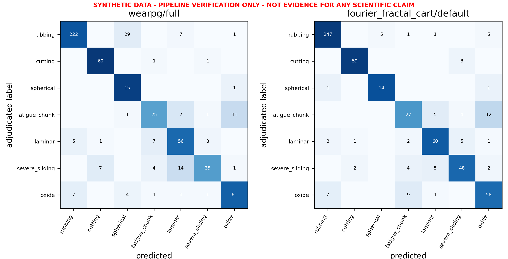
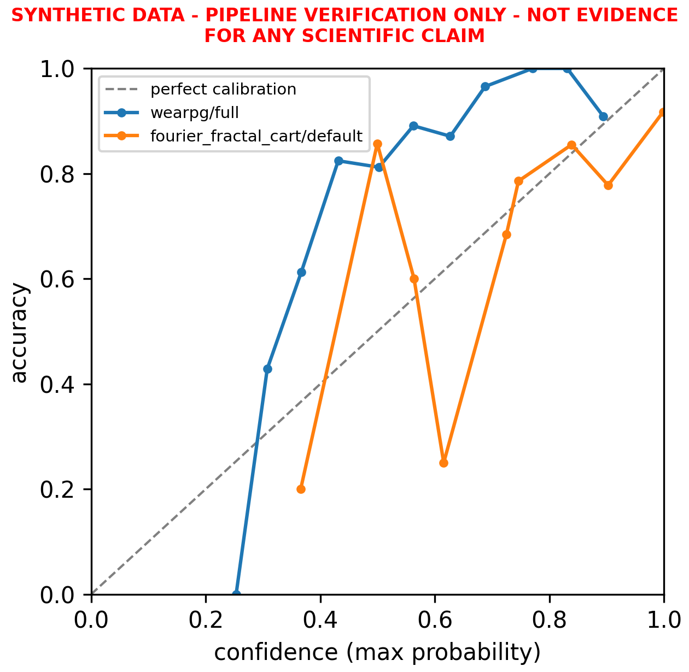
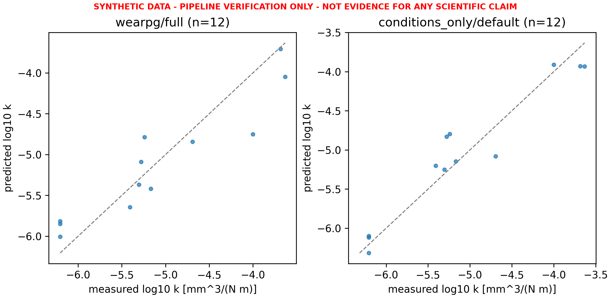
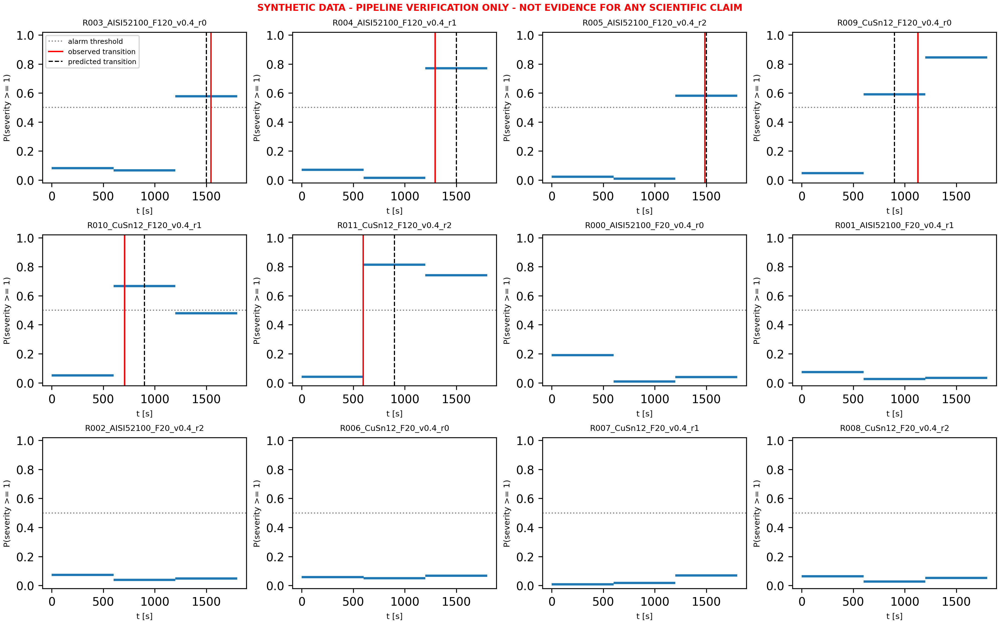
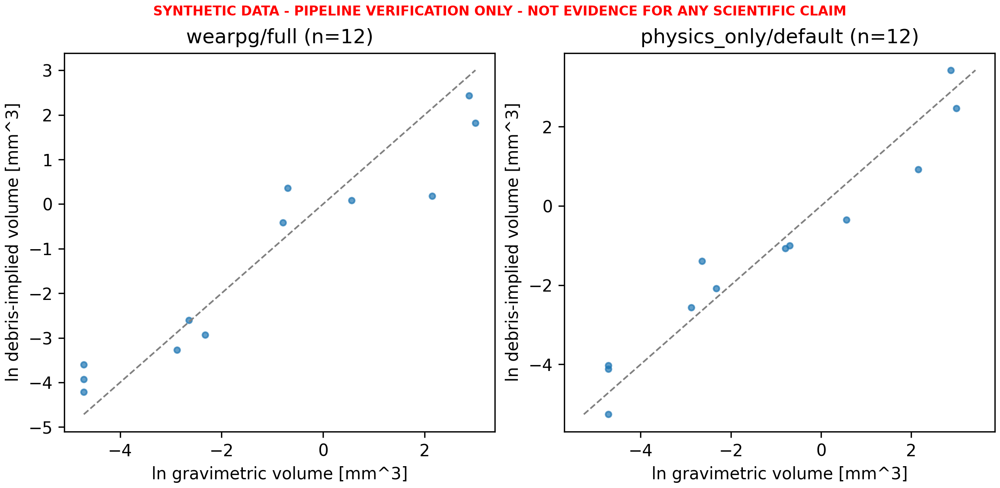
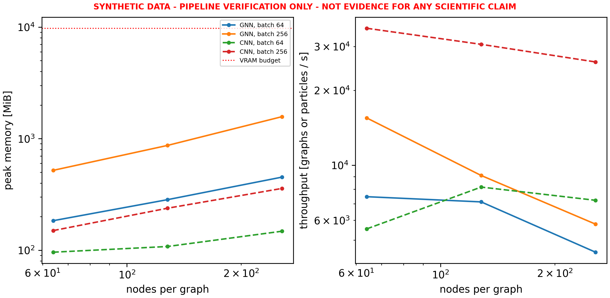

# wearpg results report

**SYNTHETIC DATA - PIPELINE VERIFICATION ONLY - NOT EVIDENCE FOR ANY SCIENTIFIC CLAIM**

**VERIFICATION ONLY - NO GO/NO-GO DECISION**

Results directory: `outputs/smoke`

## Dataset

| key | value |
|---|---|
| schema_version | 1.0 |
| is_synthetic | True |
| name | synthetic_smoke |
| generator | wearpg.synthetic |
| seed | 0 |
| warning | SYNTHETIC DATA - PIPELINE VERIFICATION ONLY - NOT EVIDENCE FOR ANY SCIENTIFIC CLAIM |
| n_specimens | 12 |
| n_runs | 12 |
| n_samples | 36 |
| n_images | 391 |
| n_particles | 590 |
| n_views | 924 |
| n_labels | 1432 |
| n_labels_adjudicated | 590 |
| n_materials | 2 |
| n_conditions | 4 |
| n_labelled_particles | 590 |

## Dataset summary

| material_id | condition_id | load [N] | speed [m/s] | runs | severe runs | samples | particles detected | particles stored | labelled |
|---|---|---|---|---|---|---|---|---|---|
| AISI52100 | AISI52100_F120_v0.4 | 120 | 0.400 | 3 | 3 | 9 | 528 | 169 | 169 |
| AISI52100 | AISI52100_F20_v0.4 | 20.0 | 0.400 | 3 | 0 | 9 | 113 | 109 | 109 |
| CuSn12 | CuSn12_F120_v0.4 | 120 | 0.400 | 3 | 3 | 9 | 2808 | 176 | 176 |
| CuSn12 | CuSn12_F20_v0.4 | 20.0 | 0.400 | 3 | 0 | 9 | 292 | 136 | 136 |
| all |  | - | - | 12 | 6 | 36 | 3741 | 590 | 590 |

## Go/no-go gates

decision_valid: false; overall: FAIL (details: ../gates/gates.md)

| gate | status | message |
|---|---|---|
| pilot | FAIL | (a) 4/4 conditions have >= 3 runs; (b) 0/4 run aggregates with p_adj < 0.05 and abs(rho) >= 0.3 (best frac_large: rho=0.77, p_adj=0.0528) |
| graph_value | FAIL | particle_gnn macro-F1 beats 0/2 baselines (lower CI bound > 0) |
| mechanism | PASS | agreement PASS (kappa=0.634 [cohen], 2 raters, 590 multi-rated items); validity PASS (kappa=0.920, n=252); SEM/EDS coverage PASS (0.427 of 590 labelled particles) |
| wear | NOT EVALUABLE | repeatability PASS (median SD log10 k = 0.160 over 4 regime-homogeneous conditions, 0 runs in regime-mixed conditions); external NOT EVALUABLE (no external run predictions) |
| portfolio | FAIL | particles macro_f1 FAIL (wearpg 0.7287 vs best baseline fourier_fractal_cart 0.8173); runs mae FAIL (wearpg 0.2898 vs best baseline conditions_only 0.2085) |

## Particle-level mechanism classification

| protocol | model | variant | Macro-F1 | Bal. acc. | Acc. | ECE | Brier | Log loss | n |
|---|---|---|---|---|---|---|---|---|---|
| cv | wearpg | full | 0.729 [0.699, 0.751] | 0.783 [0.755, 0.803] | 0.803 [0.772, 0.835] | 0.284 [0.253, 0.321] | 0.426 [0.406, 0.450] | 0.847 [0.791, 0.903] | 590 |
| cv | wearpg | no_physics | 0.744 [0.696, 0.784] | 0.797 [0.750, 0.831] | 0.815 [0.782, 0.854] | 0.277 [0.246, 0.316] | 0.398 [0.372, 0.422] | 0.811 [0.756, 0.866] | 590 |
| cv | contour_cnn | default | 0.769 [0.724, 0.801] | 0.817 [0.772, 0.844] | 0.822 [0.795, 0.847] | 0.256 [0.225, 0.283] | 0.369 [0.341, 0.401] | 0.774 [0.725, 0.834] | 590 |
| cv | fecnn | default | 0.722 [0.669, 0.757] | 0.777 [0.706, 0.818] | 0.785 [0.758, 0.810] | 0.261 [0.240, 0.283] | 0.408 [0.377, 0.435] | 0.830 [0.777, 0.880] | 590 |
| cv | fourier_fractal_cart | default | 0.817 [0.774, 0.837] | 0.825 [0.784, 0.846] | 0.869 [0.852, 0.885] | 0.080 [0.061, 0.111] | 0.233 [0.208, 0.261] | 2.531 [1.964, 3.098] | 590 |
| cv | fourier_fractal_svm | default | 0.814 [0.787, 0.835] | 0.797 [0.770, 0.819] | 0.873 [0.854, 0.898] | 0.082 [0.063, 0.120] | 0.218 [0.196, 0.240] | 0.483 [0.438, 0.526] | 590 |
| cv | multiview_svm | default | 0.788 [0.747, 0.813] | 0.760 [0.725, 0.798] | 0.863 [0.845, 0.885] | 0.125 [0.102, 0.161] | 0.251 [0.227, 0.272] | 0.544 [0.499, 0.584] | 590 |
| cv | particle_gnn | default | 0.660 [0.618, 0.698] | 0.728 [0.683, 0.759] | 0.725 [0.682, 0.769] | 0.162 [0.134, 0.204] | 0.415 [0.383, 0.450] | 0.821 [0.764, 0.877] | 590 |
| cv | resnet18 | default | 0.670 [0.628, 0.698] | 0.735 [0.692, 0.766] | 0.727 [0.701, 0.760] | 0.135 [0.105, 0.172] | 0.416 [0.389, 0.443] | 0.846 [0.801, 0.891] | 590 |

## Sample-level severity

| protocol | model | variant | Macro-F1 | Bal. acc. | Ordinal MAE | QWK | n |
|---|---|---|---|---|---|---|---|
| cv | wearpg | full | 0.488 [0.328, 0.591] | 0.583 [0.333, 0.667] | 0.222 [0.083, 0.389] | 0.759 [0.532, 0.900] | 36 |
| cv | wearpg | no_physics | 0.497 [0.328, 0.611] | 0.583 [0.333, 0.667] | 0.222 [0.083, 0.389] | 0.744 [0.501, 0.889] | 36 |
| cv | conditions_only | default | 0.801 [0.540, 0.985] | 0.750 [0.500, 0.977] | 0.111 [0.013, 0.222] | 0.868 [0.621, 0.987] | 36 |
| cv | descriptor_agg_rf | default | 0.518 [0.373, 1.000] | 0.556 [0.408, 1.000] | 0.167 [0.000, 0.361] | 0.771 [0.668, 1.000] | 36 |
| cv | physics_only | default | 0.554 [0.306, 0.645] | 0.583 [0.333, 0.667] | 0.194 [0.083, 0.333] | 0.781 [0.000, 0.889] | 36 |

## Specific wear rate

| protocol | level | model | variant | MAE | RMSE | R2 | Bias | Spearman | Within-cond. Spearman | n |
|---|---|---|---|---|---|---|---|---|---|---|
| cv | run | wearpg | full | 0.290 [0.195, 0.402] | 0.347 [0.231, 0.461] | 0.846 [0.610, 0.932] | -0.025 [-0.238, 0.153] | 0.930 [0.696, 0.995] | 0.542 [-0.626, 0.964] | 12 |
| cv | run | wearpg | no_physics | 0.592 [0.329, 0.825] | 0.744 [0.491, 0.933] | 0.292 [-0.157, 0.390] | -0.190 [-0.600, 0.184] | 0.746 [0.284, 0.963] | -0.085 [-0.966, 0.721] | 12 |
| cv | run | conditions_only | default | 0.208 [0.131, 0.293] | 0.256 [0.167, 0.326] | 0.916 [0.718, 0.971] | 0.034 [-0.107, 0.176] | 0.901 [0.655, 0.968] | -0.493 [-1.000, 0.614] | 12 |
| cv | run | descriptor_agg_rf | default | 0.688 [0.426, 0.977] | 0.825 [0.538, 1.059] | 0.130 [-0.535, 0.360] | 0.076 [-0.397, 0.535] | 0.164 [-0.448, 0.691] | -0.648 [-1.000, 0.049] | 12 |
| cv | run | physics_only | default | 0.270 [0.201, 0.350] | 0.306 [0.226, 0.385] | 0.880 [0.643, 0.944] | -0.007 [-0.173, 0.177] | 0.873 [0.473, 0.983] | 0.577 [-0.497, 0.981] | 12 |
| cv | sample | wearpg | full | 0.333 [0.273, 0.405] | 0.388 [0.320, 0.462] | 0.824 [0.608, 0.895] | -0.009 [-0.207, 0.150] | 0.881 [0.728, 0.950] | 0.890 [0.646, 0.968] | 36 |
| cv | sample | wearpg | no_physics | 0.499 [0.398, 0.608] | 0.562 [0.447, 0.670] | 0.630 [0.282, 0.748] | -0.156 [-0.461, 0.079] | 0.601 [0.219, 0.825] | 0.876 [0.683, 0.957] | 36 |
| cv | sample | conditions_only | default | - | - | - | - | - | - | 0 |
| cv | sample | descriptor_agg_rf | default | 0.281 [0.214, 0.349] | 0.336 [0.258, 0.417] | 0.868 [0.771, 0.912] | 0.025 [-0.159, 0.180] | 0.901 [0.759, 0.931] | 0.834 [0.537, 0.960] | 36 |
| cv | sample | physics_only | default | 0.269 [0.210, 0.331] | 0.320 [0.258, 0.377] | 0.880 [0.719, 0.931] | 0.047 [-0.081, 0.190] | 0.902 [0.723, 0.964] | 0.807 [0.522, 0.934] | 36 |

## Paired comparisons

Paired comparisons: difference with 95 % CI, relative difference and multiplicity-adjusted p-value. Method: paired cluster bootstrap, holm within (protocol, level, family, metric). Claim metrics with p-values; every metric's CI is in metrics/comparisons.csv.

| protocol | level | family | metric | A | B | diff [CI] | rel. diff | p | p adj. |
|---|---|---|---|---|---|---|---|---|---|
| cv | particle | ablations | macro_f1 | wearpg/full | wearpg/no_physics | -0.016 [-0.041, 0.009] | -0.021 | 0.206 | 0.206 |
| cv | run | ablations | mae | wearpg/full | wearpg/no_physics | -0.302 [-0.541, -0.058] | -0.511 | 0.013 | 0.013 |
| cv | sample | ablations | qwk | wearpg/full | wearpg/no_physics | 0.015 [0.000, 0.043] | 0.020 | 0.611 | 0.611 |
| cv | particle | baselines | macro_f1 | wearpg/full | contour_cnn/default | -0.041 [-0.071, 0.002] | -0.053 | 0.066 | 0.133 |
| cv | particle | baselines | macro_f1 | wearpg/full | fecnn/default | 0.007 [-0.029, 0.055] | 0.009 | 0.671 | 0.671 |
| cv | particle | baselines | macro_f1 | wearpg/full | fourier_fractal_cart/default | -0.089 [-0.119, -0.051] | -0.108 | 0.007 | 0.047 |
| cv | particle | baselines | macro_f1 | wearpg/full | fourier_fractal_svm/default | -0.085 [-0.124, -0.050] | -0.105 | 0.007 | 0.047 |
| cv | particle | baselines | macro_f1 | wearpg/full | multiview_svm/default | -0.059 [-0.099, -0.009] | -0.075 | 0.020 | 0.060 |
| cv | particle | baselines | macro_f1 | wearpg/full | particle_gnn/default | 0.069 [0.019, 0.118] | 0.104 | 0.013 | 0.053 |
| cv | particle | baselines | macro_f1 | wearpg/full | resnet18/default | 0.058 [0.030, 0.092] | 0.087 | 0.007 | 0.047 |
| cv | run | baselines | mae | wearpg/full | conditions_only/default | 0.081 [-0.042, 0.222] | 0.390 | 0.286 | 0.571 |
| cv | run | baselines | mae | wearpg/full | descriptor_agg_rf/default | -0.398 [-0.716, -0.090] | -0.579 | 0.020 | 0.060 |
| cv | run | baselines | mae | wearpg/full | physics_only/default | 0.020 [-0.106, 0.126] | 0.075 | 0.757 | 0.757 |
| cv | sample | baselines | qwk | wearpg/full | conditions_only/default | -0.108 [-0.406, 0.174] | -0.125 | 0.525 | 1.000 |
| cv | sample | baselines | qwk | wearpg/full | descriptor_agg_rf/default | -0.012 [-0.240, 0.177] | -0.015 | 0.963 | 1.000 |
| cv | sample | baselines | qwk | wearpg/full | physics_only/default | -0.022 [-0.305, 0.763] | -0.028 | 0.963 | 1.000 |

## Per-class metrics

Models: wearpg/full, fourier_fractal_cart/default.

| model | variant | class | Sensitivity | Specificity | F1 | n |
|---|---|---|---|---|---|---|
| wearpg | full | rubbing | 0.857 [0.802, 0.898] | 0.964 [0.935, 0.986] | 0.901 [0.869, 0.925] | 259 |
| wearpg | full | cutting | 0.968 [0.943, 1.000] | 0.985 [0.972, 0.995] | 0.923 [0.895, 0.963] | 62 |
| wearpg | full | spherical | 0.938 [0.800, 1.000] | 0.941 [0.915, 0.962] | 0.462 [0.302, 0.597] | 16 |
| wearpg | full | fatigue_chunk | 0.556 [0.352, 0.700] | 0.976 [0.963, 0.988] | 0.602 [0.434, 0.680] | 45 |
| wearpg | full | laminar | 0.778 [0.725, 0.841] | 0.944 [0.929, 0.960] | 0.713 [0.655, 0.775] | 72 |
| wearpg | full | severe_sliding | 0.574 [0.486, 0.647] | 0.989 [0.980, 0.996] | 0.686 [0.592, 0.744] | 61 |
| wearpg | full | oxide | 0.813 [0.723, 0.894] | 0.973 [0.961, 0.983] | 0.813 [0.731, 0.882] | 75 |
| fourier_fractal_cart | default | rubbing | 0.954 [0.936, 0.973] | 0.967 [0.941, 0.988] | 0.956 [0.936, 0.972] | 259 |
| fourier_fractal_cart | default | cutting | 0.952 [0.909, 1.000] | 0.994 [0.989, 1.000] | 0.952 [0.929, 0.986] | 62 |
| fourier_fractal_cart | default | spherical | 0.875 [0.630, 1.000] | 0.991 [0.985, 0.997] | 0.800 [0.577, 0.912] | 16 |
| fourier_fractal_cart | default | fatigue_chunk | 0.600 [0.414, 0.743] | 0.971 [0.957, 0.983] | 0.614 [0.454, 0.710] | 45 |
| fourier_fractal_cart | default | laminar | 0.833 [0.760, 0.905] | 0.977 [0.965, 0.987] | 0.833 [0.799, 0.868] | 72 |
| fourier_fractal_cart | default | severe_sliding | 0.787 [0.694, 0.851] | 0.983 [0.966, 0.995] | 0.814 [0.675, 0.870] | 61 |
| fourier_fractal_cart | default | oxide | 0.773 [0.645, 0.895] | 0.959 [0.944, 0.974] | 0.753 [0.669, 0.828] | 75 |

## Metrics by group

Models: wearpg/full, fourier_fractal_cart/default.

| protocol | model | variant | group_col | group | Macro-F1 | Bal. acc. | Acc. | ECE | Brier | Log loss | n |
|---|---|---|---|---|---|---|---|---|---|---|---|
| cv | wearpg | full | material_id | AISI52100 | 0.713 | 0.762 | 0.806 | 0.287 | 0.433 | 0.850 | 278 |
| cv | wearpg | full | material_id | CuSn12 | 0.741 | 0.798 | 0.801 | 0.283 | 0.420 | 0.845 | 312 |
| cv | wearpg | full | magnification | 200.0 | 0.699 | 0.762 | 0.787 | 0.274 | 0.433 | 0.846 | 329 |
| cv | wearpg | full | magnification | 500.0 | 0.756 | 0.793 | 0.824 | 0.301 | 0.418 | 0.850 | 261 |
| cv | wearpg | full | source_subset | multiview | 0.608 | 0.657 | 0.695 | 0.215 | 0.499 | 1.032 | 167 |
| cv | wearpg | full | source_subset | eds | 0.705 | 0.785 | 0.802 | 0.292 | 0.425 | 0.830 | 187 |
| cv | fourier_fractal_cart | default | material_id | AISI52100 | 0.794 | 0.802 | 0.860 | 0.092 | 0.251 | 2.573 | 278 |
| cv | fourier_fractal_cart | default | material_id | CuSn12 | 0.836 | 0.842 | 0.878 | 0.073 | 0.217 | 2.493 | 312 |
| cv | fourier_fractal_cart | default | magnification | 200.0 | 0.777 | 0.780 | 0.854 | 0.086 | 0.255 | 2.443 | 329 |
| cv | fourier_fractal_cart | default | magnification | 500.0 | 0.848 | 0.853 | 0.889 | 0.108 | 0.205 | 2.641 | 261 |
| cv | fourier_fractal_cart | default | source_subset | multiview | 0.818 | 0.795 | 0.862 | 0.111 | 0.248 | 2.870 | 167 |
| cv | fourier_fractal_cart | default | source_subset | eds | 0.823 | 0.839 | 0.872 | 0.077 | 0.226 | 2.404 | 187 |

## Transition timing

| protocol | model | variant | MAE [s] | Bias [s] | MAE [intervals] | Detection | Early alarm | False alarm | Oracle floor [s] | Interval [s] | n transition | n stable |
|---|---|---|---|---|---|---|---|---|---|---|---|---|
| cv | wearpg | full | 166 | 75.5 | 0.276 | 1.000 | 0.000 | 0.000 | 164 | 600 | 6 | 6 |
| cv | wearpg | no_physics | 166 | 75.5 | 0.276 | 1.000 | 0.000 | 0.000 | 164 | 600 | 6 | 6 |
| cv | conditions_only | default | 300 | -124 | 0.501 | 1.000 | 0.333 | 0.000 | 164 | 600 | 6 | 6 |
| cv | descriptor_agg_rf | default | 397 | -224 | 0.661 | 1.000 | 0.333 | 0.167 | 164 | 600 | 6 | 6 |
| cv | physics_only | default | 276 | 276 | 0.459 | 0.667 | 0.000 | 0.000 | 164 | 600 | 6 | 6 |

## Volume consistency

| protocol | model | variant | Mean ln ratio | SD ln ratio | Slope | Intercept | R2 | CCC | n |
|---|---|---|---|---|---|---|---|---|---|
| cv | wearpg | full | -0.100 | 0.928 | 0.775 | -0.379 | 0.920 | 0.937 | 12 |
| cv | wearpg | no_physics | -1.010 | 0.957 | 0.769 | -1.296 | 0.914 | 0.864 | 12 |
| cv | physics_only | default | -0.016 | 0.736 | 0.878 | -0.167 | 0.940 | 0.965 | 12 |

## Computational cost

Device NVIDIA GeForce RTX 5070, VRAM budget 9760 MiB, recommended max nodes per graphs-per-batch: {'64': 256, '256': 256}.

| nodes | batch | GNN peak MiB | GNN ms | GNN graphs/s | GNN status | CNN peak MiB | CNN ms | CNN particles/s | CNN status |
|---|---|---|---|---|---|---|---|---|---|
| 64 | 64 | 184 | 8.570 | 7468 | ok | 96.0 | 11.5 | 5544 | ok |
| 64 | 256 | 520 | 16.5 | 15479 | ok | 150 | 7.206 | 35525 | ok |
| 128 | 64 | 284 | 8.994 | 7116 | ok | 108 | 7.840 | 8163 | ok |
| 128 | 256 | 870 | 28.2 | 9088 | ok | 238 | 8.362 | 30616 | ok |
| 256 | 64 | 452 | 14.3 | 4466 | ok | 148 | 8.862 | 7222 | ok |
| 256 | 256 | 1574 | 44.2 | 5791 | ok | 358 | 9.844 | 26006 | ok |

## Excluded runs (counted, not scored)

No run was excluded.

## Synthetic ground-truth diagnostics (never headline results)

| table | protocol | level | model | variant | metric | point | lo | hi | n |
|---|---|---|---|---|---|---|---|---|---|
| classification | cv | - | contour_cnn | default | macro_f1_gt | 0.793 | 0.748 | 0.828 | 590 |
| classification | cv | - | contour_cnn | default | balanced_accuracy_gt | 0.853 | 0.810 | 0.874 | 590 |
| classification | cv | - | contour_cnn | default | accuracy_gt | 0.849 | 0.828 | 0.868 | 590 |
| classification | cv | - | contour_cnn | default | ece_gt | 0.283 | 0.260 | 0.305 | 590 |
| classification | cv | - | contour_cnn | default | brier_gt | 0.340 | 0.315 | 0.372 | 590 |
| classification | cv | - | contour_cnn | default | log_loss_gt | 0.691 | 0.653 | 0.741 | 590 |
| classification | cv | - | fecnn | default | macro_f1_gt | 0.743 | 0.688 | 0.778 | 590 |
| classification | cv | - | fecnn | default | balanced_accuracy_gt | 0.809 | 0.745 | 0.846 | 590 |
| classification | cv | - | fecnn | default | accuracy_gt | 0.807 | 0.783 | 0.829 | 590 |
| classification | cv | - | fecnn | default | ece_gt | 0.283 | 0.265 | 0.302 | 590 |
| classification | cv | - | fecnn | default | brier_gt | 0.387 | 0.357 | 0.413 | 590 |
| classification | cv | - | fecnn | default | log_loss_gt | 0.775 | 0.731 | 0.818 | 590 |
| classification | cv | - | fourier_fractal_cart | default | macro_f1_gt | 0.840 | 0.792 | 0.860 | 590 |
| classification | cv | - | fourier_fractal_cart | default | balanced_accuracy_gt | 0.856 | 0.822 | 0.871 | 590 |
| classification | cv | - | fourier_fractal_cart | default | accuracy_gt | 0.893 | 0.874 | 0.909 | 590 |
| classification | cv | - | fourier_fractal_cart | default | ece_gt | 0.060 | 0.042 | 0.096 | 590 |
| classification | cv | - | fourier_fractal_cart | default | brier_gt | 0.185 | 0.161 | 0.213 | 590 |
| classification | cv | - | fourier_fractal_cart | default | log_loss_gt | 1.655 | 1.129 | 2.309 | 590 |
| classification | cv | - | fourier_fractal_svm | default | macro_f1_gt | 0.838 | 0.808 | 0.857 | 590 |
| classification | cv | - | fourier_fractal_svm | default | balanced_accuracy_gt | 0.827 | 0.796 | 0.850 | 590 |
| classification | cv | - | fourier_fractal_svm | default | accuracy_gt | 0.898 | 0.879 | 0.919 | 590 |
| classification | cv | - | fourier_fractal_svm | default | ece_gt | 0.108 | 0.089 | 0.132 | 590 |
| classification | cv | - | fourier_fractal_svm | default | brier_gt | 0.175 | 0.156 | 0.192 | 590 |
| classification | cv | - | fourier_fractal_svm | default | log_loss_gt | 0.376 | 0.348 | 0.402 | 590 |
| classification | cv | - | multiview_svm | default | macro_f1_gt | 0.813 | 0.770 | 0.840 | 590 |
| classification | cv | - | multiview_svm | default | balanced_accuracy_gt | 0.790 | 0.748 | 0.829 | 590 |
| classification | cv | - | multiview_svm | default | accuracy_gt | 0.890 | 0.871 | 0.913 | 590 |
| classification | cv | - | multiview_svm | default | ece_gt | 0.152 | 0.133 | 0.180 | 590 |
| classification | cv | - | multiview_svm | default | brier_gt | 0.214 | 0.191 | 0.238 | 590 |
| classification | cv | - | multiview_svm | default | log_loss_gt | 0.460 | 0.421 | 0.498 | 590 |
| classification | cv | - | particle_gnn | default | macro_f1_gt | 0.680 | 0.632 | 0.722 | 590 |
| classification | cv | - | particle_gnn | default | balanced_accuracy_gt | 0.757 | 0.710 | 0.793 | 590 |
| classification | cv | - | particle_gnn | default | accuracy_gt | 0.746 | 0.700 | 0.793 | 590 |
| classification | cv | - | particle_gnn | default | ece_gt | 0.182 | 0.148 | 0.226 | 590 |
| classification | cv | - | particle_gnn | default | brier_gt | 0.390 | 0.354 | 0.425 | 590 |
| classification | cv | - | particle_gnn | default | log_loss_gt | 0.745 | 0.698 | 0.791 | 590 |
| classification | cv | - | resnet18 | default | macro_f1_gt | 0.688 | 0.642 | 0.719 | 590 |
| classification | cv | - | resnet18 | default | balanced_accuracy_gt | 0.765 | 0.727 | 0.792 | 590 |
| classification | cv | - | resnet18 | default | accuracy_gt | 0.749 | 0.723 | 0.779 | 590 |
| classification | cv | - | resnet18 | default | ece_gt | 0.157 | 0.125 | 0.193 | 590 |
| classification | cv | - | resnet18 | default | brier_gt | 0.391 | 0.366 | 0.416 | 590 |
| classification | cv | - | resnet18 | default | log_loss_gt | 0.779 | 0.734 | 0.818 | 590 |
| classification | cv | - | wearpg | full | macro_f1_gt | 0.750 | 0.713 | 0.773 | 590 |
| classification | cv | - | wearpg | full | balanced_accuracy_gt | 0.817 | 0.789 | 0.837 | 590 |
| classification | cv | - | wearpg | full | accuracy_gt | 0.827 | 0.796 | 0.856 | 590 |
| classification | cv | - | wearpg | full | ece_gt | 0.308 | 0.279 | 0.341 | 590 |
| classification | cv | - | wearpg | full | brier_gt | 0.399 | 0.378 | 0.426 | 590 |
| classification | cv | - | wearpg | full | log_loss_gt | 0.746 | 0.711 | 0.793 | 590 |
| classification | cv | - | wearpg | no_physics | macro_f1_gt | 0.767 | 0.712 | 0.810 | 590 |
| classification | cv | - | wearpg | no_physics | balanced_accuracy_gt | 0.831 | 0.787 | 0.865 | 590 |
| classification | cv | - | wearpg | no_physics | accuracy_gt | 0.841 | 0.807 | 0.879 | 590 |
| classification | cv | - | wearpg | no_physics | ece_gt | 0.302 | 0.275 | 0.339 | 590 |
| classification | cv | - | wearpg | no_physics | brier_gt | 0.372 | 0.347 | 0.397 | 590 |
| classification | cv | - | wearpg | no_physics | log_loss_gt | 0.719 | 0.676 | 0.762 | 590 |
| regression | cv | sample | conditions_only | default | mae_gt | - | - | - | 0 |
| regression | cv | sample | conditions_only | default | rmse_gt | - | - | - | 0 |
| regression | cv | sample | conditions_only | default | r2_gt | - | - | - | 0 |
| regression | cv | sample | conditions_only | default | bias_gt | - | - | - | 0 |
| regression | cv | sample | conditions_only | default | spearman_gt | - | - | - | 0 |
| regression | cv | sample | conditions_only | default | within_condition_spearman_gt | - | - | - | 0 |
| regression | cv | sample | descriptor_agg_rf | default | mae_gt | 0.278 | 0.212 | 0.347 | 36 |
| regression | cv | sample | descriptor_agg_rf | default | rmse_gt | 0.333 | 0.257 | 0.414 | 36 |
| regression | cv | sample | descriptor_agg_rf | default | r2_gt | 0.870 | 0.775 | 0.913 | 36 |
| regression | cv | sample | descriptor_agg_rf | default | bias_gt | 0.023 | -0.158 | 0.176 | 36 |
| regression | cv | sample | descriptor_agg_rf | default | spearman_gt | 0.896 | 0.755 | 0.929 | 36 |
| regression | cv | sample | descriptor_agg_rf | default | within_condition_spearman_gt | 0.827 | 0.536 | 0.957 | 36 |
| regression | cv | sample | physics_only | default | mae_gt | 0.273 | 0.214 | 0.335 | 36 |
| regression | cv | sample | physics_only | default | rmse_gt | 0.324 | 0.259 | 0.381 | 36 |
| regression | cv | sample | physics_only | default | r2_gt | 0.877 | 0.709 | 0.929 | 36 |
| regression | cv | sample | physics_only | default | bias_gt | 0.046 | -0.084 | 0.192 | 36 |
| regression | cv | sample | physics_only | default | spearman_gt | 0.893 | 0.703 | 0.955 | 36 |
| regression | cv | sample | physics_only | default | within_condition_spearman_gt | 0.784 | 0.455 | 0.936 | 36 |
| regression | cv | sample | wearpg | full | mae_gt | 0.332 | 0.270 | 0.405 | 36 |
| regression | cv | sample | wearpg | full | rmse_gt | 0.387 | 0.319 | 0.460 | 36 |
| regression | cv | sample | wearpg | full | r2_gt | 0.824 | 0.610 | 0.897 | 36 |
| regression | cv | sample | wearpg | full | bias_gt | -0.011 | -0.206 | 0.150 | 36 |
| regression | cv | sample | wearpg | full | spearman_gt | 0.874 | 0.657 | 0.948 | 36 |
| regression | cv | sample | wearpg | full | within_condition_spearman_gt | 0.878 | 0.576 | 0.969 | 36 |
| regression | cv | sample | wearpg | no_physics | mae_gt | 0.496 | 0.395 | 0.605 | 36 |
| regression | cv | sample | wearpg | no_physics | rmse_gt | 0.560 | 0.445 | 0.666 | 36 |
| regression | cv | sample | wearpg | no_physics | r2_gt | 0.633 | 0.284 | 0.750 | 36 |
| regression | cv | sample | wearpg | no_physics | bias_gt | -0.157 | -0.460 | 0.075 | 36 |
| regression | cv | sample | wearpg | no_physics | spearman_gt | 0.611 | 0.223 | 0.826 | 36 |
| regression | cv | sample | wearpg | no_physics | within_condition_spearman_gt | 0.883 | 0.673 | 0.953 | 36 |
| regression | cv | run | conditions_only | default | mae_gt | 0.204 | 0.127 | 0.287 | 12 |
| regression | cv | run | conditions_only | default | rmse_gt | 0.250 | 0.163 | 0.320 | 12 |
| regression | cv | run | conditions_only | default | r2_gt | 0.919 | 0.726 | 0.972 | 12 |
| regression | cv | run | conditions_only | default | bias_gt | 0.033 | -0.104 | 0.172 | 12 |
| regression | cv | run | conditions_only | default | spearman_gt | 0.909 | 0.659 | 0.993 | 12 |
| regression | cv | run | conditions_only | default | within_condition_spearman_gt | -0.427 | -1.000 | 0.897 | 12 |
| regression | cv | run | descriptor_agg_rf | default | mae_gt | 0.684 | 0.423 | 0.974 | 12 |
| regression | cv | run | descriptor_agg_rf | default | rmse_gt | 0.821 | 0.534 | 1.056 | 12 |
| regression | cv | run | descriptor_agg_rf | default | r2_gt | 0.132 | -0.533 | 0.364 | 12 |
| regression | cv | run | descriptor_agg_rf | default | bias_gt | 0.075 | -0.395 | 0.530 | 12 |
| regression | cv | run | descriptor_agg_rf | default | spearman_gt | 0.225 | -0.386 | 0.754 | 12 |
| regression | cv | run | descriptor_agg_rf | default | within_condition_spearman_gt | -0.573 | -1.000 | 0.370 | 12 |
| regression | cv | run | physics_only | default | mae_gt | 0.269 | 0.201 | 0.350 | 12 |
| regression | cv | run | physics_only | default | rmse_gt | 0.305 | 0.224 | 0.385 | 12 |
| regression | cv | run | physics_only | default | r2_gt | 0.880 | 0.640 | 0.945 | 12 |
| regression | cv | run | physics_only | default | bias_gt | -0.008 | -0.173 | 0.177 | 12 |
| regression | cv | run | physics_only | default | spearman_gt | 0.860 | 0.466 | 0.978 | 12 |
| regression | cv | run | physics_only | default | within_condition_spearman_gt | 0.566 | -0.657 | 0.982 | 12 |
| regression | cv | run | wearpg | full | mae_gt | 0.286 | 0.193 | 0.398 | 12 |
| regression | cv | run | wearpg | full | rmse_gt | 0.344 | 0.228 | 0.459 | 12 |
| regression | cv | run | wearpg | full | r2_gt | 0.848 | 0.611 | 0.933 | 12 |
| regression | cv | run | wearpg | full | bias_gt | -0.026 | -0.237 | 0.151 | 12 |
| regression | cv | run | wearpg | full | spearman_gt | 0.930 | 0.693 | 1.000 | 12 |
| regression | cv | run | wearpg | full | within_condition_spearman_gt | 0.559 | -0.621 | 1.000 | 12 |
| regression | cv | run | wearpg | no_physics | mae_gt | 0.589 | 0.327 | 0.820 | 12 |
| regression | cv | run | wearpg | no_physics | rmse_gt | 0.741 | 0.490 | 0.930 | 12 |
| regression | cv | run | wearpg | no_physics | r2_gt | 0.293 | -0.156 | 0.391 | 12 |
| regression | cv | run | wearpg | no_physics | bias_gt | -0.191 | -0.601 | 0.180 | 12 |
| regression | cv | run | wearpg | no_physics | spearman_gt | 0.734 | 0.244 | 0.954 | 12 |
| regression | cv | run | wearpg | no_physics | within_condition_spearman_gt | -0.098 | -0.990 | 0.676 | 12 |

## Figures

